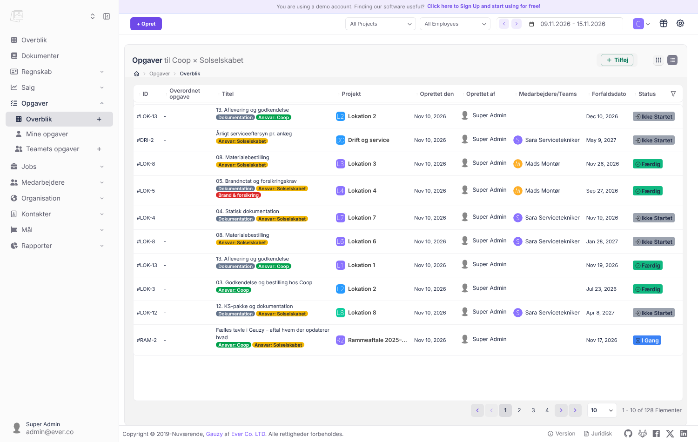
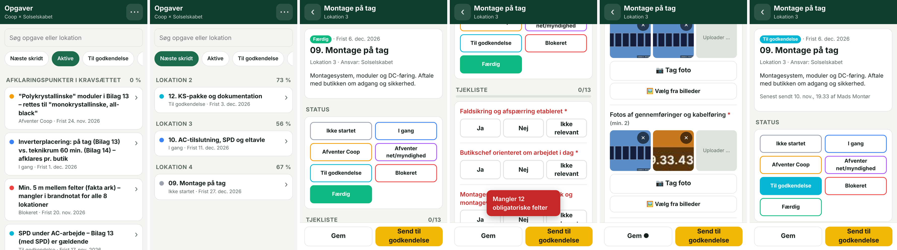
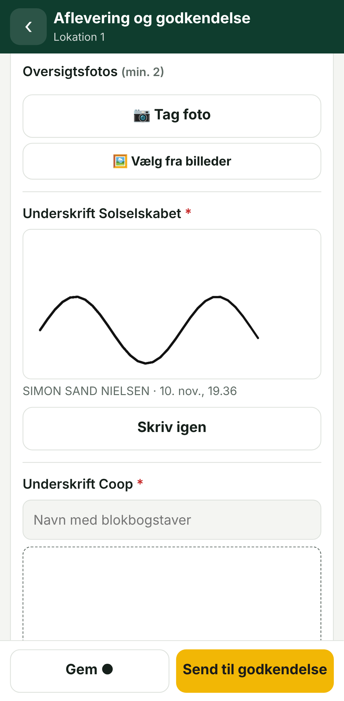

# Coop × Solselskabet: dansk projektplatform med feltapp

[Ever Gauzy](https://github.com/ever-co/ever-gauzy) er et open source-alternativ til Monday.com. Her er det sat op på dansk til Solselskabets opgaver for Coop og har fået en mobil-app til håndværkerne.

| Del | Adresse | Til hvem |
|---|---|---|
| **Gauzy på dansk** – alle funktioner | http://localhost:4200 | Kontoret: Coop og Solselskabets projektledere |
| **Feltapp** – tjeklister, fotos, underskrift | http://&lt;pc-ens-ip&gt;:8080 | Montører og serviceteknikere på telefonen |



## 1. Gauzy på dansk

Hele brugerfladen er oversat til dansk (7.000 tekster): menuer, knapper, formularer og meddelelser i alle moduler. Det gælder projekter, opgaver, tidsregistrering, timesedler, medarbejdere, teams, mål/KPI, kontakter, tilbud, fakturaer, udgifter, lager, udstyr, dokumenter og rapporter.

- Oversættelsen ligger i `dansk/da.json` og lægges oven på Gauzys engelske sprogfil (se `docker-compose.yml`). Selve programmet er ikke ændret.
- Nogle få tekster er skrevet direkte ind i Gauzys kode og kan ikke oversættes uden at ombygge programmet. Det gælder fx demobanneret øverst og datovælgerens "Today/Last Week".
- Vil du rette en oversættelse, så ret i `dansk/da.json` og genindlæs siden.

## 2. Feltappen til telefonen



En mobil-app, der bruger samme data som Gauzy. Det, montøren udfylder, kan kontoret se med det samme.

- **Opgaveliste pr. lokation** med fremdrift i %. Filtrene er *Næste skridt*, *Aktive*, *Til godkendelse*, *Færdige* og *Mine*, og der er søgning. Forsinkede opgaver er markeret med rødt.
- **Status** skiftes med store knapper.
- **Tjekliste på hver opgave** med felttyperne ja/nej/ikke relevant, tal med enhed, valgliste, fritekst, foto og underskrift. Obligatoriske felter er markeret med `*`.
- **Fotos** tages direkte med kameraet eller vælges fra billeder. De bliver automatisk gjort mindre og får lokation og tidspunkt stemplet på.
- **Underskrift med fingeren** ved aflevering og service, med navn og tidspunkt.
- **"Send til godkendelse"** er spærret, indtil alle obligatoriske felter er udfyldt. Appen springer selv ned til det første felt, der mangler.
- **Kladde på telefonen.** Svarene gemmes løbende på telefonen, så intet går tabt ved dårlig dækning.
- **Kontoret ser rapporten.** Ved afsendelse skrives en læsbar feltrapport med tabel og fotos ind i opgavens beskrivelse i Gauzy.
- Appen kan lægges på hjemmeskærmen ("Føj til startskærm") og fungerer i lyst og mørkt tema.

**Tjeklisterne** er defineret i `app/tjeklister.js`: screening, montage på tag, AC/SPD, idriftsættelse (isolationsmåling, Voc, Isc), aflevering (DKV-plan, skilte, to underskrifter), årligt serviceeftersyn og termografi. Alle andre opgaver får en kort standardtjekliste. Ret, tilføj eller fjern felter direkte i filen. Ændringer slår igennem, så snart siden genindlæses.



## Sådan kører du det

Kræver [Docker Desktop](https://www.docker.com/products/docker-desktop/) og [Node.js](https://nodejs.org) 18 eller nyere.

```bash
cd solselskabet-gauzy
./start.sh
```

Første start tager 3–6 minutter. Bagefter skriver scriptet adresserne ud.

**Logins (kun til demo – skift dem før rigtig brug):**

| Hvem | E-mail | Adgangskode | Ser |
|---|---|---|---|
| Kontor/administrator | admin@ever.co | admin | Alt (vælg *Coop × Solselskabet* øverst til højre) |
| Montør | montoer@solselskabet.demo | Montoer2026! | Står på Lokation 1–4 |
| Servicetekniker | service@solselskabet.demo | Service2026! | Står på Lokation 5–8 + drift |

**Telefonen** skal være på samme wifi som pc'en. Åbn den adresse, `start.sh` skriver ud, fx `http://192.168.1.23:8080`. Giv eventuelt Windows-firewallen lov til port 8080.

På Windows uden bash: kopiér `env.template` til `.env`, udfyld de fire `JWT_*`/`EXPRESS_SESSION_SECRET`-linjer med lange tilfældige strenge, kør `docker compose up -d`, vent til http://localhost:3000/api/health svarer, og kør `node seed/seed.mjs`.

## Indhold i demoen

Organisationen **Coop × Solselskabet** har 11 projekter og 128 opgaver:

| Projekt | Indhold |
|---|---|
| **Lokation 1–8** | 14 faser pr. anlæg: screening → tilbud/PVSOL → godkendelse → statik → brandnotat → myndighed/net → materialer → montage → AC/SPD → idriftsættelse → KS-pakke → aflevering → Dalux |
| **Rammeaftale 2025–2030** | Opstart, månedsrapport, samarbejdsmøder, rateplan (Bilag 1), prisregulering 01.01.2027 |
| **Drift og service** | Overvågning, årligt eftersyn, fejlmelding via Dalux, termografi, garantisager |
| **Afklaringspunkter i kravsættet** | Polykrystallinsk-formuleringen, inverterplacering, 5 m mellem felter, SPD |

Statusserne er *Ikke startet · I gang · Afventer Coop · Afventer net/myndighed · Til godkendelse · Blokeret · Færdig*.

> **Status på opgaverne er eksempler.** Butiksnavne og kWp er ikke udfyldt. Ret dem i `seed/data.mjs`, og kør `node seed/seed.mjs --reset`.
> Bemærk: `--reset` sletter organisationen og alt, hvad der er udfyldt i feltappen.

## Godt at vide

- **Demotilstand.** Gauzy kører i demotilstand, så Gauzys egne eksempelfirmaer ligger også i databasen. Vælg den rigtige organisation, når du viser det frem.
- **Hvor data gemmes.** Feltrapportens rådata (JSON) gemmes som en kommentar på opgaven. Fotos ligger i Gauzys filarkiv. Den læsbare rapport står i opgavebeskrivelsen.
- **Billeder fra andre pc'er.** Billeder i Gauzys opgavebeskrivelse peger på `localhost:3000`. De vises derfor kun på den pc, der kører systemet. Skal andre pc'er bruge det, så sæt `API_BASE_URL` og `CLIENT_BASE_URL` i `.env` til pc'ens IP-adresse.
- **Rigtig drift.** Til rigtig brug skal det på en server med https og et domæne. Så kan appen også installeres fuldt som app på telefonen og virke offline.
- **Login-begrænsning.** Login er rate-begrænset. Får du "forkert login" lige efter mange forsøg, så vent et minut.
- **Stop og slet.** Stop med `docker compose down`. Slet alt inkl. data med `docker compose down -v`.
